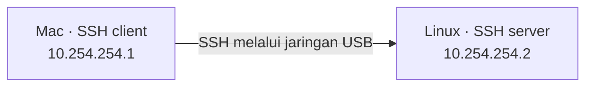

# SSH dari Mac ke Linux melalui USB

Patch ini membantu Linux mengenali interface jaringan USB pada Mac berbasis Apple Silicon agar Linux bisa diakses melalui SSH dari Terminal macOS. Linux berperan sebagai server dan Mac sebagai client. Setelah jaringan USB siap, koneksi tidak memerlukan Wi-Fi atau router.



## Kebutuhan dan kompatibilitas

Siapkan kabel USB-C yang mendukung transfer data, akses administrator pada Linux, dan akses pengaturan jaringan pada Mac. Target utama patch adalah Ubuntu 24.04 dengan kernel 6.8 serta perangkat USB Apple dengan vendor ID `05ac` dan product ID `1902` atau `1905`. Pada Ubuntu, siapkan tool pemeriksaan dengan perintah:

```bash
sudo apt update && sudo apt install usbutils iproute2 ethtool
```

## Kapan patch diperlukan

Patch diperlukan jika driver bawaan belum mengenali perangkat Mac atau belum menangani interface NCM tanpa status endpoint. Untuk menjalankan pemeriksaan, hubungkan kabel USB, lalu jalankan perintah berikut pada Ubuntu:

```bash
# Periksa kernel
uname -r

# Periksa perangkat USB Apple
lsusb -d 05ac:

# Periksa interface jaringan
ip -br link

# Periksa log driver pada boot saat ini
sudo journalctl -k -b --no-pager | grep -iE 'cdc_ncm|05ac|bind.*failure'
```

Jika Mac terdeteksi tetapi interface USB tidak muncul dengan pesan `bind() failure`, cocokkan product ID dengan dukungan patch. Jika Mac tidak terdeteksi, periksa kabel dan port. Jika koneksi USB sudah berjalan dengan driver bawaan, lewati build dan instalasi patch, lalu lanjutkan ke pengaturan jaringan dan SSH.

## Build dan instalasi

Unduh repository dan buka terminal di foldernya pada Ubuntu. Pasang dependensi build, lalu build sebagai pengguna biasa:

```bash
sudo apt install build-essential linux-headers-$(uname -r) kmod mokutil
make
```

Pada sistem EFI, periksa status Secure Boot:

```bash
mokutil --sb-state
```

Jika Secure Boot aktif, lakukan signing dan daftarkan key melalui MOK sesuai [panduan Ubuntu](https://documentation.ubuntu.com/security/security-features/platform-protections/secure-boot/) sebelum memasang modul. Simpan private key di luar repository.

Pasang modul:

```bash
sudo make install
```

Jika installer menolak modul pengganti yang sudah ada, periksa asalnya sebelum menghapus atau menggantinya. Jika driver dimuat melalui initramfs, perbarui initramfs sesuai panduan distribusi. Simpan pekerjaan, lalu restart dari terminal lokal atau koneksi lain yang dapat digunakan kembali setelah restart:

```bash
sudo reboot
```

## Atur jaringan USB pada Ubuntu

Cari interface USB, lalu pastikan drivernya `cdc_ncm`. Ganti `INTERFACE_LINUX` dengan interface yang menuju Mac.

```bash
ip -br link
ethtool -i INTERFACE_LINUX
```

Periksa alamat dan route yang sudah ada agar subnet contoh tidak bertabrakan dengan jaringan lain:

```bash
ip -4 address
ip -4 route show table all
```

Jika alamat belum terpasang, pasang alamat lalu aktifkan interface:

```bash
sudo ip address add 10.254.254.2/30 dev INTERFACE_LINUX
sudo ip link set dev INTERFACE_LINUX up
```

Jika muncul dua interface NCM, pilih pasangan yang sesuai dan gunakan subnet ini hanya pada satu pasangan. Pengaturan ini sementara, jadi gunakan network manager untuk menyimpannya secara permanen.

## Atur jaringan USB pada Mac

Buka **System Settings > Network** dan pilih koneksi USB ke Linux. Atur IPv4 menjadi `10.254.254.1`, subnet mask `255.255.255.252`, serta kosongkan router dan DNS tambahan.

Jika koneksi tidak tercantum, cari interface USB lalu atur alamat sementara. Ganti `INTERFACE_MAC` dengan interface USB yang benar pada Mac (namanya dapat berbeda dari Ubuntu).

```bash
networksetup -listallhardwareports
sudo ifconfig INTERFACE_MAC inet 10.254.254.1 netmask 255.255.255.252 up
```

Pertahankan Wi-Fi dan Ethernet utama, lalu uji koneksi ke Ubuntu:

```bash
ping -c 3 10.254.254.2
```

Jika subnet contoh sudah dipakai, sesuaikan alamat kedua komputer dan perintah berikutnya dengan subnet kosong yang dipilih.

## Aktifkan SSH dan masuk dari Mac

Pada Ubuntu, pasang dan aktifkan server SSH:

```bash
sudo apt install openssh-server
sudo systemctl enable --now ssh
```

Jika UFW aktif, izinkan koneksi SSH melalui interface USB, lalu tinjau izin SSH lain yang sudah ada:

```bash
sudo ufw allow in on INTERFACE_LINUX to 10.254.254.2 port 22 proto tcp
```

Dari Mac, masuk ke Ubuntu dengan mengganti `USER` sesuai akun Ubuntu Anda:

```bash
ssh USER@10.254.254.2
```

Cocokkan fingerprint host dengan server melalui jalur tepercaya sebelum menerima host key pada koneksi pertama.

## Jika koneksi gagal

| Gejala | Yang diperiksa |
| --- | --- |
| Interface USB tidak muncul | Perangkat, log driver, dan Secure Boot |
| Interface tersedia tetapi koneksi gagal | Pasangan interface, alamat IP, dan firewall (status `UNKNOWN` saja tidak membuktikan koneksi gagal) |
| SSH: `Connection refused` | Layanan dan port SSH |
| SSH: timeout | Koneksi dan firewall |
| SSH: `Permission denied` | Akun dan autentikasi |

## Menghapus patch

Pada Ubuntu, jalankan dari folder repository:

```bash
sudo make uninstall
```

Jika driver dimuat melalui initramfs, perbarui initramfs sesuai panduan distribusi, lalu restart untuk memilih driver bawaan. Penghapusan hanya berlaku untuk modul pengganti pada kernel yang sedang digunakan.

Hapus alamat sementara jika masih terpasang, lalu batalkan pengaturan USB pada Mac:

```bash
sudo ip address del 10.254.254.2/30 dev INTERFACE_LINUX
```

Konfigurasi permanen, layanan SSH, dan aturan firewall dikelola secara terpisah.

## Pemeliharaan dan lisensi

Periksa kebutuhan patch setelah pembaruan kernel. Driver pengganti dapat memengaruhi perangkat NCM lain dan tidak otomatis menerima perbaikan distribusi. Kode asal Linux v6.8 mempertahankan lisensi GPLv2 atau BSD 2-Clause, sedangkan materi proyek memakai GPL-2.0-only. Proyek ini independen dan tidak berafiliasi dengan Apple Inc. Apple dan Mac merupakan merek dagang Apple Inc.
